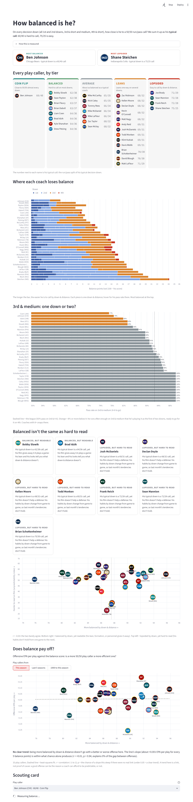
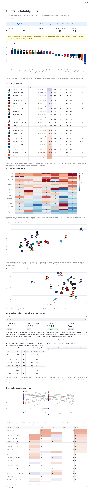
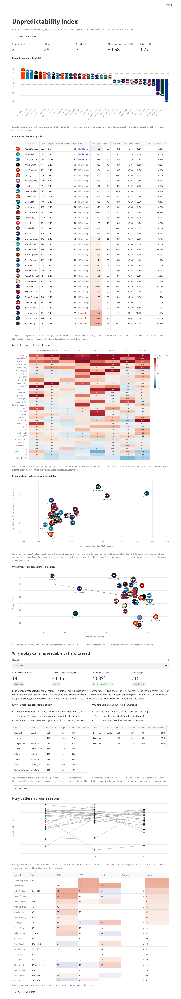
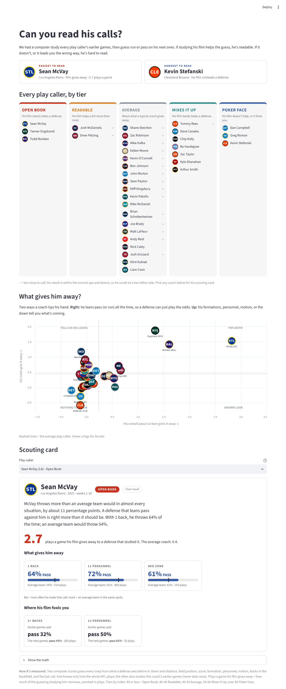
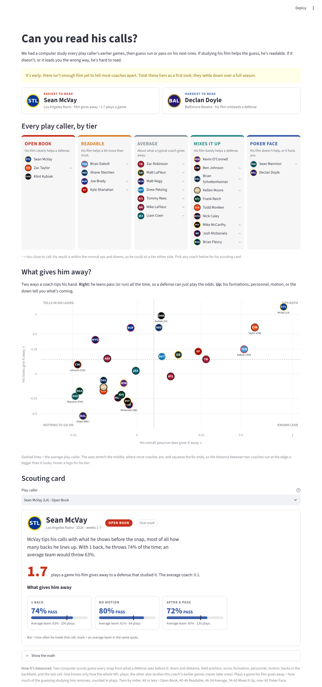
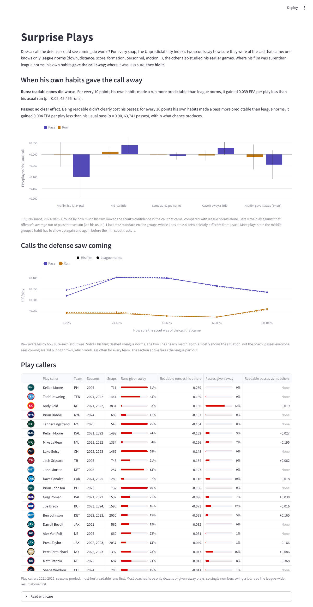
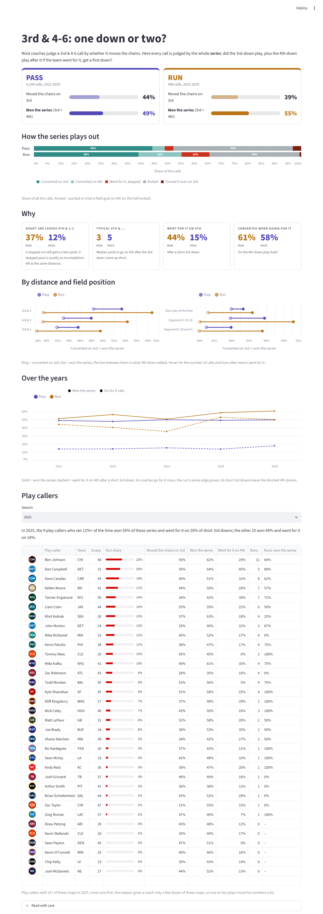

# NFL Tendencies

The [Dowling Catholic Football Analytics](https://github.com/zcalvert29/Dowling-Football) app's **Scout Opposing
Offense** page, rebuilt for any NFL offense on [nflfastR](https://www.nflfastr.com/) play-by-play. Same views,
colors, and tendency grading, with two additions throughout:

- **PROE (pass rate over expected):** how much more often a team throws than an average NFL team would in the exact
  same spots (down, distance, field position, score, time, timeouts), from nflfastR's `xpass` model.
- **League-wide situational averages:** every table can carry "NFL" columns, which are the league's numbers for the
  same row with the same filters (the NFL's pass rate on 3rd & long next to the team's 3rd & long). The run/pass
  bars mark the NFL's split, the run-lane and pass-zone pictures show and color against the NFL's number in the same
  lane or zone, and the red zone numbers show the difference from the NFL.

## Pages

Every page covers 1999 to the season in progress (see [Data](#data) for what starts later).

### Tendencies

Pick an offense in the sidebar. Five tabs:

| Tab | What it shows |
|---|---|
| **Tendencies** | Down & distance: a scouting-report sentence for each box that clearly differs from an average team (10+ plays, PROE of 5%+ either way), then the full grid (pass %, run/pass bar, a PROE chip where it stands out, play count; expected and NFL pass rates and the most-used formation on hover); PROE charts by down & distance and by game situation (their pass rate, expected pass rate, and the NFL's actual pass rate); offensive, formation, and personnel tendency tables; 3rd and 4th downs with NFL conversion rates; every 3rd/4th down call; best 10 plays |
| **Sequencing** | What they call after a run, a pass, a completion, an incompletion, a big gain, a loss, a play that worked or didn't, and on a new set of downs, each with the NFL's pass rate after the same kind of snap and PROE; by down after a run or a pass |
| **Red zone** | Trips, touchdown rate, scoring rate, points per trip, and trips per game against the NFL; how trips ended; how it's called in each zone inside the 20 with NFL pass rate, success, and EPA; formations and personnel inside the 20; run/pass by direction between the 11 and 20 and inside the 10 |
| **Run game** | Run-lane diagram (EPA and carries for each of nflfastR's seven lanes, colored against the NFL's EPA in the same lane); runs by lane, formation, distance, personnel, and box count; ball carriers; best runs |
| **Pass game** | Pass-zone heatmap (direction × depth, each zone shaded against the NFL's number in the same zone); pass chart of every throw; passes by depth, formation, coverage, and man/zone; targets; best passes |

**Sidebar filters:** season, season type, week, down, distance, situation (neutral, red zone, goal to go, backed
up, 3rd & short, short yardage, long yardage, two-minute), and a minimum-plays cutoff. NFL comparisons always use
the same filters across all 32 teams.

### Balance Score

How close to 50/50 each play caller calls run and pass on each decision down.
For each down & distance, his pass rate's squared gap from 50%, minus the part a small sample makes by chance
(p(1 − p)/(n − 1), so a 3-of-4 cell isn't a tendency yet); averaged over the cells weighted by snaps; then
**100 × (1 − 4 × that average)**.

- **Counted:** every 1st and 2nd down, 3rd & short and medium, 4th & short. **Left out:** 3rd & 7+ (every team
  throws) and 4th & 4+ (a handful of snaps, nearly all passes). 3rd & medium stays on purpose: coaches who run there
  are playing it as the first of two downs, ready to go for it on 4th.
- **Typical call:** the score in football terms, the run/pass split of his typical decision down (87.5 = a 68/32
  call). **Tiers:** Coin Flip (62/38 or closer), Balanced, Average, Leans, Lopsided (beyond 71/29).
- **On the page:** the two ends of the scale; a tier board; **where each coach loses balance** (points lost per down &
  distance, adding up to 100 minus his score); **3rd & medium: one down or two?** (pass rate there against the league;
  8+ points below = a two-down set); **balanced isn't the same as hard to read** (callouts where balance and the film
  index disagree, plus the scatter); and a **scouting card** with a written verdict, his typical call season by
  season, and his decision downs in the Tendencies tab's down & distance grid (run/pass bar, PROE chip, plays, and
  points lost). The score bars, a points-lost heatmap, and the full table are under **Show the math**.
- **Does balance pay off?** Each play caller's offense against his balance score, with a least-squares line and a
  plain verdict on whether a trend exists (correlation, p-value, and how much of the gap between offenses it
  explains). Pick the offense measure (EPA/play, success rate, explosive rate, 3rd-down conversion, points per drive),
  the span (this season, the last 5, or 1999 to this season; pooled seasons compare each offense with that season's
  average), and **neutral game script only** (within 8 points, outside the 4th quarter). The offense is always
  measured on the same decision-down snaps the score uses. So far: no link within a season, and pooled over
  1999-2025 a tiny one (r ≈ -0.08, 1% of the gap): more balanced play callers did not run better offenses.
- **A coach over the years:** any play caller with 3+ seasons, his balance and his offense season by season; and,
  across every such coach, whether his offense did better in seasons he was more balanced than his own norm (no).
- **Split by shotgun / under center** (sidebar toggle) scores each down separately from each formation, closer to
  what a defense sees before the snap. Every caller looks about 5 points more lopsided that way, so the tiers move up.
- **Reliability** (odd vs even games): 0.75 in 2024, 0.40 in 2025; early in a season the page warns that most of the
  gap between coaches is still noise. The balance score and the film index barely agree (r ≈ 0): McVay is an average
  66/34 caller by down & distance but the easiest coach to read on film.



### Unpredictability Index

How much a defense learns by studying a play caller's film, beyond knowing how the NFL calls the same spots. Two
scouts predict run or pass on every snap from what's visible **before** the snap:

- **NFL scout:** nflfastR's `xpass` (down, distance, field position, score, time, timeouts) plus the league's
  tendency in each look: formation, personnel, motion, backfield count, and whether the last snap was a run or a pass.
  Fit on the other 31 teams. Knows nothing about this offense.
- **Film scout:** starts from the NFL scout and learns this play caller's own tendencies from **his earlier games
  only** (game 4 from games 1-3, game 5 from 1-4, ...): his overall pass/run lean and his habits by situation and look.
  Each habit is pulled hard toward 0 until the film shows it again and again (a ridge-penalized logistic model with
  the NFL scout as its offset). A play caller who takes over mid-season starts a fresh film study.

**Film edge** = how much better the film scout predicts games it hadn't seen, in bits per 100 snaps (log loss). A
tendency that doesn't repeat costs the film scout, so the edge can be negative: the film misleads. The edge splits into
**from lean** (a film scout that knows only his overall lean) and **from looks** (the rest). The **unpredictability
index** is the film edge as a T-score, flipped: 50 = an average NFL play caller that season, 60+ = hard to read, 40 and
below = readable.

**On the page:** the index as bars from 50 in team colors with logos; a table of every play caller (film edge with its
±2 SE, lean vs looks, NFL-scout vs film-scout accuracy, the biggest tell, each clue's edge, EPA, PROE); a heatmap of
which clues give each caller away; lean vs habits; EPA per play vs the index with its trend; a **why** section for any caller (a
summary, the looks where his film caught a tell, and the looks where it misled); and each play caller's index across
seasons. **Sidebar:** season, weeks, compare play callers or teams, minimum snaps, highlight teams.

**Play callers** come from `play_callers.csv` (season, team, play caller, role, first and last week, confidence,
note), covering every team from 1999 through 2026 with mid-season changes (958 rows). No public dataset of play
callers exists, so the list was built from each game's head coach in the play-by-play, coordinator histories, and
team and media reports. Confidence: **high** (765 rows) = widely reported; **medium** (179) = reported but shared,
disputed, or not confirmed in a source; **low** (14) = best guess from who held the coordinator job, mostly Atlanta
2000-03, Arizona 2002-03, and a few interim stretches. Corrections are one CSV row each.

**What it shows so far:** most of the reliable difference between callers is lean (a defense that knows McVay throws
~11 points over expected all year can read him); habits by look are real but small and noisier. Split-half reliability
of the film edge: 0.50 (2023), 0.56 (2024), 0.77 (2025). Seven weeks into 2026 it's still mostly noise, and the page
says so.

| 2026 (default view) | 2025 |
|---|---|
|  |  |

These screenshots also use stand-in logo badges.

#### At a glance (default view)

The same film index in plain words, for anyone who watches football. Pick **View** in the sidebar to switch between
**At a glance** and **Show the math** (every number and chart described above).

- **Tiers** instead of scores: *Open Book* (index 40 or less), *Readable*, *Average*, *Mixes It Up*, *Poker Face*
  (over 60). A "~" marks coaches too close to call, whose result is within normal ups and downs.
- **Plays a game his film gives away:** the share of the guessing his film removes, times his snaps per game. McVay
  2.7 in 2025; the average coach 0.4.
- **The two ends of the scale**, a **tier board** of every play caller, and a **four-box picture**: his overall lean
  gives it away (across) vs his looks give it away (up), with the corners named *Tips both*, *Known lean*, *Tells in
  his looks*, *Nothing to go on*.
- **Does being hard to read pay off?** Each play caller's offense against the index, with a least-squares line and a
  plain verdict on the trend, with the same choices as the Balance Score page (offense measure, span, neutral game
  script); the offense is measured on the same snaps the index scores (also under Show the math).
  Within one season there's no clear trend; pooled over several seasons, harder-to-read play callers ran slightly
  *less* efficient offenses (about -0.015 to -0.03 EPA per play per 10 index points, r ≈ -0.15 to -0.29). It's a link,
  not a cause: an offense with a great quarterback can afford to be predictable.
- **A coach over the years:** his index and his offense season by season (Andy Reid was readable and well above
  average in 2018-22), and, across 812 seasons from 112 play callers with 3+ seasons, the same comparison within each
  coach: in seasons a coach was harder to read than his own norm, his offense was slightly *less* efficient (about
  -0.017 EPA per play per 10 index points; small, but more than chance).
- **Scouting card** for any coach: a written verdict, his biggest tells as cards ("11 personnel: 72% PASS, average
  team 61%"), where his film fooled a defense, and a "Show the math" drawer.

| 2025 | 2026 |
|---|---|
|  |  |

### Surprise Plays

Play by play: does a call the defense could see coming do worse? For every film-scored snap, the Unpredictability
Index's two scouts say how sure they were of the call that came: one knows only league norms, the other also studied
the play caller's earlier games. Where his film was surer than league norms, his own habits **gave the call away**;
where it was less sure, they **hid it**.

- **When his own habits gave the call away:** each run or pass against that offense's usual run or pass that season
  (so a great quarterback's predictable passes don't count as "predictable passes work"; a switch shows the raw
  numbers), grouped by how much his habits gave it away, with ±2 standard errors and a verdict for runs and passes.
  2021-25, about 109,000 snaps: **readable runs did worse** (-0.039 EPA per play and 2.7 percentage points lower
  success for every 10 points his habits gave a run away), while **readable passes didn't** (no EPA difference, and
  slightly *higher* success). Raw, readable passes look much better, but that's the quarterback: good passing teams
  are the ones whose film says pass.
- **Calls the defense saw coming:** outcome by how sure each scout was. His film and league norms nearly match, so this
  mostly shows the situation (3rd & long throws everyone sees coming work less often).
- **Play callers:** how often his runs and passes were given away, and how his given-away calls did against his other
  calls. **Sidebar:** seasons, outcome (EPA/play, success rate, explosive rate), raw vs within-offense, minimum plays.



### 3rd and Medium

Judges a 3rd-down call by the whole **series**: did the 3rd-down play, plus the 4th-down play after it if the team
went for it, get a first down? Every 3rd-down run or pass is followed to the next 4th-down run, pass, punt, or field
goal in the same drive. Defaults to 3rd & 4-6 over the last five complete seasons; the sidebar picks the seasons
(1999 on), the distance, and the field position.

- **Pass vs run:** moved the chains on 3rd vs won the series. On 3rd & 4-6 in 2021-25, runs convert fewer 3rd downs
  than passes (39% vs 44%) but win more series (55% vs 49%): a stopped run leaves 4th & 1-2 37% of the time (12% for a
  pass), and teams go for it after 44% of short runs vs 15% of short passes.
- **How the series plays out** (converted on 3rd or 4th, stopped on 4th, kicked, turned over), **why** (4th-down
  distance, go-for-it and 4th-down conversion rates), **by distance and field position**, **over the years** (three
  then-vs-now numbers and run vs pass by era since 1999: runs won 45% of these series in 1999-2005 and 55% since
  2020, as going for it after a short run rose from 15% to 43%), and **play callers** for any season, with their
  run share, series rate, and go-for-it rate.
- **Read with care:** the run's edge is mostly the two-down plan, not the play (coaches who run there already intend
  to go for it), and runs on 3rd & medium are rare, so a coach's own numbers rest on a handful of plays.



## Data

- **Play-by-play:** nflfastR from the [nflverse data releases](https://github.com/nflverse/nflverse-data/releases):
  EPA, success, `xpass` / `pass_oe`, pass direction and air yards, run location and gap.
- **Participation charting** (2016 on): nflverse's participation file adds formation, personnel, men in the box,
  and coverage. nflverse publishes it after each season, so **the season in progress has no personnel, box count, or
  coverage yet**; formation falls back to nflfastR's shotgun / under center flag, and those tables say so.
- **Seasons:** 1999 to the season in progress. Not everything goes back that far, and anything a season doesn't
  have is left out of that season's pages and scores rather than shown blank:

  | Data | From |
  |---|---|
  | Every play, EPA, success, shotgun, run lane | 1999 |
  | Expected pass rate (`xpass`) and PROE; pass direction and air yards | 2006 |
  | Personnel, formation, box count, coverage | 2016 |
  | Motion, play action, RPO, backfield count | 2022 |

  Before 2006 the Tendencies tab drops PROE columns and charts and the pass zones and pass chart; the Unpredictability
  Index's league scout uses the league's pass rate in each down & distance in place of `xpass`. nflfastR uses today's team abbreviations throughout (the 1999 Rams are
  `LA`, the Chargers `LAC`, the Raiders `LV`), so old seasons show today's team names and logos.
- **FTN charting** (2022 on, updated during the season): motion at the snap, play action, RPO, screens, and the
  number of backs in the backfield. A season file saved before this was added downloads again once.

**Logos** are downloaded once from ESPN's CDN, shrunk, cached in `data/logos/`, and embedded in the charts (a
hotlinked image can fail to draw on Vega's canvas). Screenshots in this README use stand-in badges (team color and
abbreviation) because the machine that took them couldn't reach the CDN.

The app downloads each season the first time it's picked and keeps a slimmed copy in `data/` (about 5 MB a
season). The season in progress is re-downloaded every 12 hours so new weeks show up.

## Project structure

```
app.py              Navigation between the pages
page_tendencies.py  Tendencies page: sidebar filters, tabs
page_balance.py     Balance Score page
page_surprise.py    Surprise Plays page
surprise.py         Play-by-play surprise analysis (no Streamlit code)
ui.py               Shared pieces for the play-caller pages (team colors and logos, charts, EPA trend)
page_unpredictability.py  Unpredictability Index page
unpredictability.py The unpredictability model (no Streamlit code)
page_series.py      3rd and Medium page
series.py           3rd-down series outcomes (no Streamlit code)
play_callers.csv    Who called each team's offensive plays, by season and week
data.py             Downloads nflfastR pbp + participation; builds the app's columns
common.py           Metrics, NFL comparison columns, table colors, tendency badges, split bars
tab_tendencies.py   Tendencies tab
tab_sequencing.py   Sequencing tab
tab_red_zone.py     Red zone tab
tab_run_game.py     Run game tab (run-lane diagram)
tab_pass_game.py    Pass game tab (pass zones)
pass_chart.py       The pass chart drawing
tests/              Unit tests
docs/               Screenshots
```

## Running locally

```bash
git clone https://github.com/zcalvert29/NFL-Tendencies.git
cd NFL-Tendencies
pip install -r requirements.txt
streamlit run app.py
```

Optional: `python data.py 2024 2025 2026` downloads seasons ahead of time. Run the tests with `python -m pytest`.

## Definitions

- **EPA:** expected points added (nflfastR). **Success:** a play with positive EPA (nflfastR's definition; the
  Dowling app uses the 40/70/100% yardage rule).
- **Explosive:** a run of 10+ or a pass of 20+ yards.
- **Personnel:** RBs (incl. FBs) then TEs, so "11" = 1 RB, 1 TE, 3 WR; "+OL" = an extra lineman.
- **Tell / lean / small sample:** how much to trust a 70%+ split, graded by the Wilson lower bound (90%), as in the
  Dowling app.
- **Colors:** from the scouted offense's side. With an NFL column, green/red = clearly better/worse than the NFL in
  that row. Without one, the Dowling offense rule. Rows under 5 plays aren't colored; rows under 10 are grayed.

## Author
**Zack Calvert** · [LinkedIn](https://linkedin.com/in/zack-calvert) · [Substack](https://zcalvert.substack.com)
