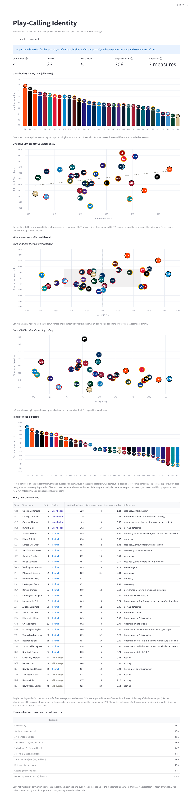
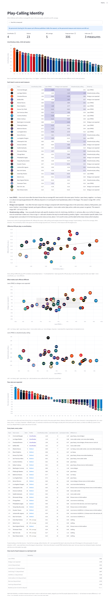
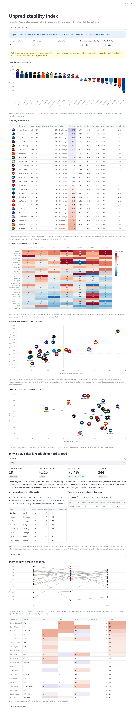
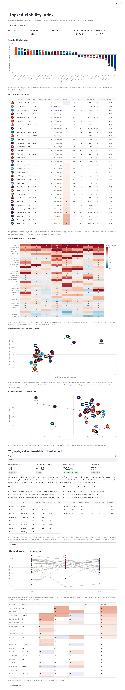
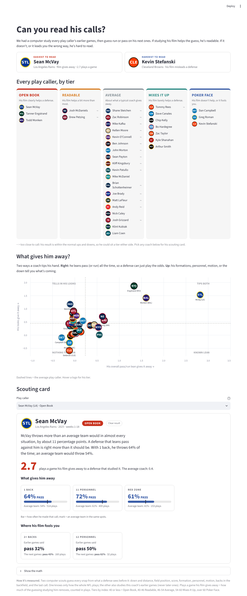
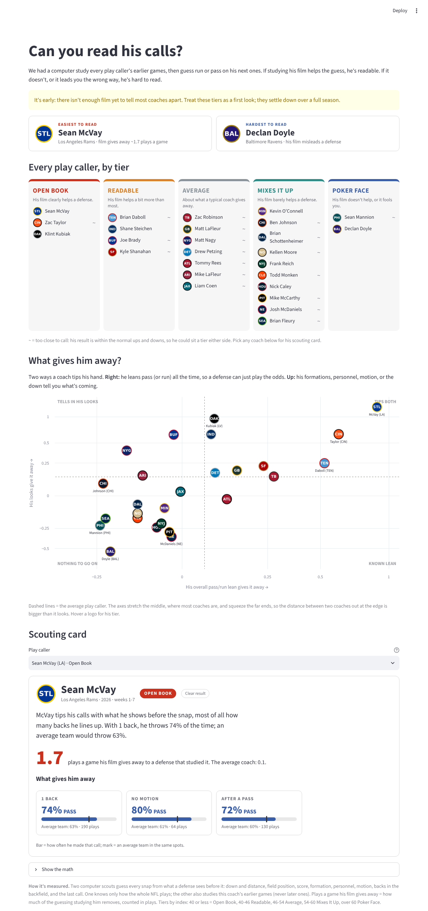
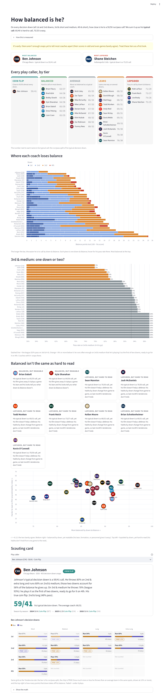
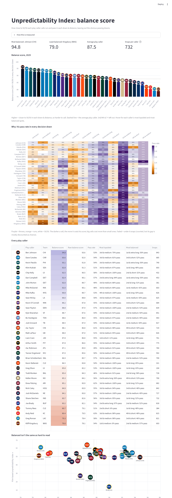

# NFL Tendencies

The [Dowling Catholic Football Analytics](https://github.com/zcalvert29/Dowling-Football) app's **Scout Opposing
Offense** page, rebuilt for any NFL offense on [nflfastR](https://www.nflfastr.com/) play-by-play. Same views,
colors, and tendency grading, with two additions throughout:

- **PROE (pass rate over expected):** how much more often a team throws than an average NFL team would in the exact
  same spots (down, distance, field position, score, time, timeouts), from nflfastR's `xpass` model.
- **League-wide situational averages:** every table can carry "NFL" columns, which are the league's numbers for the
  same row with the same filters (the NFL's pass rate on 3rd & long next to the team's 3rd & long). The run/pass
  bars mark the NFL's split, the run-lane and pass-zone pictures show and color against the NFL's number in the same
  lane or zone, and the red zone numbers show the difference from the NFL.

## Pages

### Tendencies

Pick an offense in the sidebar. Five tabs:

| Tab | What it shows |
|---|---|
| **Tendencies** | Down & distance: a scouting-report sentence for each box that clearly differs from an average team (10+ plays, PROE of 5%+ either way), then the full grid (pass %, run/pass bar, a PROE chip where it stands out, play count; expected and NFL pass rates and the most-used formation on hover); PROE charts by down & distance and by game situation (their pass rate, expected pass rate, and the NFL's actual pass rate); offensive, formation, and personnel tendency tables; 3rd and 4th downs with NFL conversion rates; every 3rd/4th down call; best 10 plays |
| **Sequencing** | What they call after a run, a pass, a completion, an incompletion, a big gain, a loss, a play that worked or didn't, and on a new set of downs, each with the NFL's pass rate after the same kind of snap and PROE; by down after a run or a pass |
| **Red zone** | Trips, touchdown rate, scoring rate, points per trip, and trips per game against the NFL; how trips ended; how it's called in each zone inside the 20 with NFL pass rate, success, and EPA; formations and personnel inside the 20; run/pass by direction between the 11 and 20 and inside the 10 |
| **Run game** | Run-lane diagram (EPA and carries for each of nflfastR's seven lanes, colored against the NFL's EPA in the same lane); runs by lane, formation, distance, personnel, and box count; ball carriers; best runs |
| **Pass game** | Pass-zone heatmap (direction × depth, each zone shaded against the NFL's number in the same zone); pass chart of every throw; passes by depth, formation, coverage, and man/zone; targets; best passes |

**Sidebar filters:** season, season type, week, down, distance, situation (neutral, red zone, goal to go, backed
up, 3rd & short, short yardage, long yardage, two-minute), and a minimum-plays cutoff. NFL comparisons always use
the same filters across all 32 teams.

### Play-Calling Identity

Which offenses call it unlike an average NFL team in the same spots, and which are NFL average. Every snap is compared
with what the rest of the league does in that exact spot (the team is left out of its own baseline), on four
measures:

| Measure | Compared with |
|---|---|
| **Lean (PROE)** | nflfastR's `xpass`, re-centered on what the rest of the league actually did in the same spots that season (the model was fit on earlier seasons and expects more passing on 3rd/4th & 1-2 than today's NFL does) |
| **Shotgun over expected** | the rest of the league's shotgun rate in the same down × distance × field zone × score state |
| **3+ WR personnel over expected** | the rest of the league's 3+ WR rate in the same spots (seasons with FTN charting only) |
| **Situational play calling** | in 13 situations (1st & 10, 2nd & short/long, 3rd/4th & 1-2, 3rd & medium, red zone, goal to go, backed up, leading, trailing, after a run, after a pass, first 15 snaps): how much more or less the team throws than the rest of the league does there, *beyond its own overall lean* |

Each measure gets a game-clustered z-score and an empirical-Bayes shrunk value in units of the real team-to-team
spread (noisy situations shrink toward 0, so they barely move the index; each situation needs a Bonferroni-adjusted
z to be flagged). The **unorthodoxy index** is the root mean square of those: 0 = calls it like an average team,
1 = one typical team-to-team spread away on each measure. *Unorthodox* = index ≥ 1.0; *NFL average* = not detectably
and materially different on any measure; *Distinct* = in between.

**Reading the index:** the unit is a typical team-to-team gap, so 1.0 = about one typical gap from average across the
measures. It has no direction (pass-heavy and run-heavy both count) and no grade (unusual isn't good or bad). Even the
most average offenses land around 0.3-0.4, since squares can't cancel and some noise survives the shrinkage; across
2021-25 the median team is about 0.77, the top quarter 1.07+, and the top 10% 1.3+.

**On the page:** the index as bars in each team's primary color with its logo on top; a table of each team's score on
each measure (with which measure drives its index) and a short guide to reading each measure; offensive EPA per play vs
the index; lean vs shotgun, lean vs personnel, and lean vs situational play calling (logos only); pass rate over expected
per team as bars in team colors with logos; a table of every value; and split-half reliabilities. Every chart uses team colors and logos. Logos are downloaded once from ESPN's CDN,
shrunk, cached in `data/logos/`, and embedded in the charts (a hotlinked image can fail to draw on Vega's canvas).

**Sidebar filters:** season (defaults to the latest), week range, score window, last 2 minutes of a half, which
measures and situations go into the index, and which teams to show (conference, division, profile, highlight).
A measure a season doesn't have (personnel in the season in progress) is left out of that season's index and table.

| 2026 (default view) | 2025 |
|---|---|
|  |  |

The logos in these two screenshots are stand-in badges (team color and abbreviation): the machine that took them
couldn't reach ESPN's CDN. The app shows the real logos.

### Unpredictability Index

How much a defense learns by studying a play caller's film, beyond knowing how the NFL calls the same spots. Two
scouts predict run or pass on every snap from what's visible **before** the snap:

- **NFL scout:** nflfastR's `xpass` (down, distance, field position, score, time, timeouts) plus the league's
  tendency in each look: formation, personnel, motion, backfield count, and whether the last snap was a run or a pass.
  Fit on the other 31 teams. Knows nothing about this offense.
- **Film scout:** starts from the NFL scout and learns this play caller's own tendencies from **his earlier games
  only** (game 4 from games 1-3, game 5 from 1-4, ...): his overall pass/run lean and his habits by situation and look.
  Each habit is pulled hard toward 0 until the film shows it again and again (a ridge-penalized logistic model with
  the NFL scout as its offset). A play caller who takes over mid-season starts a fresh film study.

**Film edge** = how much better the film scout predicts games it hadn't seen, in bits per 100 snaps (log loss). A
tendency that doesn't repeat costs the film scout, so the edge can be negative: the film misleads. The edge splits into
**from lean** (a film scout that knows only his overall lean) and **from looks** (the rest). The **unpredictability
index** is the film edge as a T-score, flipped: 50 = an average NFL play caller that season, 60+ = hard to read, 40 and
below = readable.

**On the page:** the index as bars from 50 in team colors with logos; a table of every play caller (film edge with its
±2 SE, lean vs looks, NFL-scout vs film-scout accuracy, the biggest tell, each clue's edge, EPA, PROE); a heatmap of
which clues give each caller away; lean vs habits and EPA vs index scatters; a **why** section for any caller (a
summary, the looks where his film caught a tell, and the looks where it misled); and each play caller's index across
seasons. **Sidebar:** season, weeks, compare play callers or teams, minimum snaps, highlight teams.

**Play callers** come from `play_callers.csv` (season, team, play caller, role, first and last week, confidence),
filled in for 2024-2026 from team and media reports. A season without rows treats each team as one play caller.

**What it shows so far:** most of the reliable difference between callers is lean (a defense that knows McVay throws
~11 points over expected all year can read him); habits by look are real but small and noisier. Split-half reliability
of the film edge: 0.50 (2023), 0.56 (2024), 0.77 (2025). Seven weeks into 2026 it's still mostly noise, and the page
says so.

| 2026 (default view) | 2025 |
|---|---|
|  |  |

These screenshots also use stand-in logo badges.

#### At a glance (default view)

The same film index in plain words, for anyone who watches football. Pick **View** in the sidebar to switch between
**At a glance**, **Show the math** (every number and chart described above), and **Balance score**.

- **Tiers** instead of scores: *Open Book* (index 40 or less), *Readable*, *Average*, *Mixes It Up*, *Poker Face*
  (over 60). A "~" marks coaches too close to call, whose result is within normal ups and downs.
- **Plays a game his film gives away:** the share of the guessing his film removes, times his snaps per game. McVay
  2.7 in 2025; the average coach 0.4.
- **The two ends of the scale**, a **tier board** of every play caller, and a **four-box picture**: his overall lean
  gives it away (across) vs his looks give it away (up), with the corners named *Tips both*, *Known lean*, *Tells in
  his looks*, *Nothing to go on*.
- **Scouting card** for any coach: a written verdict, his biggest tells as cards ("11 personnel: 72% PASS, average
  team 61%"), where his film fooled a defense, and a "Show the math" drawer.

| 2025 | 2026 |
|---|---|
|  |  |

#### Balance score

Picked with **View** in the sidebar: how close to 50/50 each play caller calls run and pass on each decision down.
For each down & distance, his pass rate's squared gap from 50%, minus the part a small sample makes by chance
(p(1 − p)/(n − 1), so a 3-of-4 cell isn't a tendency yet); averaged over the cells weighted by snaps; then
**100 × (1 − 4 × that average)**.

- **Counted:** every 1st and 2nd down, 3rd & short and medium, 4th & short. **Left out:** 3rd & 7+ (every team
  throws) and 4th & 4+ (a handful of snaps, nearly all passes). 3rd & medium stays on purpose: coaches who run there
  are playing it as the first of two downs, ready to go for it on 4th.
- **Typical call:** the score in football terms, the run/pass split of his typical decision down (87.5 = a 68/32
  call). **Tiers:** Coin Flip (62/38 or closer), Balanced, Average, Leans, Lopsided (beyond 71/29).
- **On the page:** the two ends of the scale; a tier board; **where each coach loses balance** (points lost per down &
  distance, adding up to 100 minus his score); **3rd & medium: one down or two?** (pass rate there against the league;
  8+ points below = a two-down set); **balanced isn't the same as hard to read** (callouts where balance and the film
  index disagree, plus the scatter); and a **scouting card** with a written verdict, his typical call season by
  season, and his decision downs in the Tendencies tab's down & distance grid (run/pass bar, PROE chip, plays, and
  points lost). The score bars, a points-lost heatmap, and the full table are under **Show the math**.
- **Split by shotgun / under center** (sidebar toggle) scores each down separately from each formation, closer to
  what a defense sees before the snap. Every caller looks about 5 points more lopsided that way, so the tiers move up.
- **Reliability** (odd vs even games): 0.75 in 2024, 0.40 in 2025; early in a season the page warns that most of the
  gap between coaches is still noise. The balance score and the film index barely agree (r ≈ 0): McVay is an average
  66/34 caller by down & distance but the easiest coach to read on film.

| 2026 | 2025 |
|---|---|
|  |  |

## Data

- **Play-by-play:** nflfastR from the [nflverse data releases](https://github.com/nflverse/nflverse-data/releases):
  EPA, success, `xpass` / `pass_oe`, pass direction and air yards, run location and gap.
- **Participation charting:** nflverse's FTN participation file adds formation, personnel, men in the box, and
  coverage. nflverse publishes it after each season, so **the season in progress has no personnel, box count, or
  coverage yet**; formation falls back to nflfastR's shotgun / under center flag, and those tables say so.
- **FTN charting** (2022 on, updated during the season): motion at the snap, play action, RPO, screens, and the
  number of backs in the backfield. A season file saved before this was added downloads again once.

The app downloads each season the first time it's picked and keeps a slimmed copy in `data/` (about 5 MB a
season). The season in progress is re-downloaded every 12 hours so new weeks show up.

## Project structure

```
app.py              Navigation between the pages
page_tendencies.py  Tendencies page: sidebar filters, tabs
page_identity.py    Play-Calling Identity page
identity.py         Play-calling identity measures (no Streamlit code)
page_unpredictability.py  Unpredictability Index page
unpredictability.py The unpredictability model (no Streamlit code)
play_callers.csv    Who called each team's offensive plays, by season and week
data.py             Downloads nflfastR pbp + participation; builds the app's columns
common.py           Metrics, NFL comparison columns, table colors, tendency badges, split bars
tab_tendencies.py   Tendencies tab
tab_sequencing.py   Sequencing tab
tab_red_zone.py     Red zone tab
tab_run_game.py     Run game tab (run-lane diagram)
tab_pass_game.py    Pass game tab (pass zones)
pass_chart.py       The pass chart drawing
tests/              Unit tests
docs/               Screenshots
```

## Running locally

```bash
git clone https://github.com/zcalvert29/NFL-Tendencies.git
cd NFL-Tendencies
pip install -r requirements.txt
streamlit run app.py
```

Optional: `python data.py 2024 2025 2026` downloads seasons ahead of time. Run the tests with `python -m pytest`.

## Definitions

- **EPA:** expected points added (nflfastR). **Success:** a play with positive EPA (nflfastR's definition; the
  Dowling app uses the 40/70/100% yardage rule).
- **Explosive:** a run of 10+ or a pass of 20+ yards.
- **Personnel:** RBs (incl. FBs) then TEs, so "11" = 1 RB, 1 TE, 3 WR; "+OL" = an extra lineman.
- **Tell / lean / small sample:** how much to trust a 70%+ split, graded by the Wilson lower bound (90%), as in the
  Dowling app.
- **Colors:** from the scouted offense's side. With an NFL column, green/red = clearly better/worse than the NFL in
  that row. Without one, the Dowling offense rule. Rows under 5 plays aren't colored; rows under 10 are grayed.

## Author
**Zack Calvert** · [LinkedIn](https://linkedin.com/in/zack-calvert) · [Substack](https://zcalvert.substack.com)
